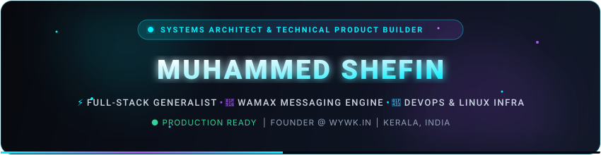
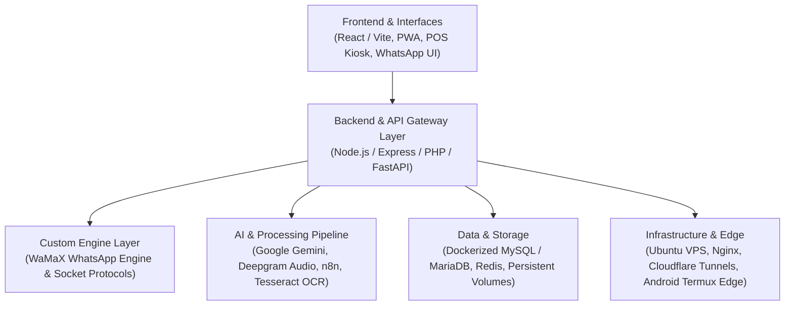

<!-- Pure Native Animated Cyber Header (Zero 3rd-party dependencies) -->

 

<!-- Real-Time Typing Animation -->

  

<!-- Animated System Status Dock (Single-Row, Pulsing Radar, Zero Wrapping) -->

  

 

<h3 align="center">🌐 Quick Connect &amp; Social Ecosystem</h3>

   &nbsp;
   &nbsp;
   &nbsp;
   &nbsp;
  

<!-- Animated Laser Beam Divider -->

## 👨‍💻 Engineering Profile & Overview

Hi there!  I am **Muhammed Shefin**, a **Full-Stack Technology Generalist, Systems & Infrastructure Specialist, and Technical Product Builder**.

My work spans the full technical spectrum: understanding core business requirements, diagnosing complex operational bottlenecks across code and infrastructure, engineering scalable solutions, and managing continuous production deployments.

Rather than looking at software solely as isolated code files, I engineer complete, resilient operational ecosystems — connecting responsive user interfaces, robust backend APIs, custom messaging protocols, relational database persistence, AI-driven automation pipelines, and bare-metal server infrastructure.

- 🚀 **Founder & Technical Lead**: Heading **[WhatYouWantKerala (wywk.in)](https://wywk.in)** and **MSA MODS** engineering initiatives.
- 🤖 **Custom Messaging Engine Architecture**: Creator of **WaMaX & WaMaX-Lite**, a high-concurrency custom WhatsApp automation engine featuring multi-device session management, strict anti-ban rate limiting, and interactive messaging payloads.
- 🖨️ **Hardware, IoT & Edge Systems**: Creator of **[AndroPrint](https://github.com/msamods/androprint)** (zero-PC thermal printing server via Android Termux + Node.js) and designer of distributed LoRa/GNSS hardware tracking architectures.
- 🐳 **Server Administration & DevOps**: Hands-on Linux systems administrator managing Docker container environments, multi-version MySQL/MariaDB deployments, persistent volume architectures, Cloudflare Tunnels, PM2 process management, and live incident recovery.
- 🛡️ **Production QA & Root-Cause Troubleshooting**: Multi-layer investigative debugging across devices, networks, APIs, databases, and servers (e.g., stabilizing live restaurant apps with GrubTech integrations).
- 📈 **SEO, GEO & Digital Growth**: Technical SEO, Generative Engine Optimization (GEO), Answer Engine Optimization (AEO), Schema.org (JSON-LD), and Google Analytics certified.
- 🎓 **Academics**: BCA (2nd Year) @ **Vivekananda Global University**

 

<!-- Interactive Live System Terminal Animation -->

  

<!-- Animated Laser Beam Divider -->

## 🏗️ The 5 Core Technical Capability Pillars

<table width="100%">
  <tr>
    <td width="50%" valign="top">
      <h3>💻 1. Software & Application Development</h3>
      <ul>
        <li><b>Frontend Engineering:</b> HTML5, CSS3, modern JavaScript, React.js, Vite + TypeScript, and Progressive Web Apps (PWA) designed for mobile-first workflows.</li>
        <li><b>Backend & Microservices:</b> Node.js, Express.js, PHP, Go concepts, RESTful API design, and JSON payload contracts.</li>
        <li><b>Application Architecture:</b> Attendance management, inventory & ERP concepts, offline-first POS systems, and service delivery platforms.</li>
        <li><b>State & Validation:</b> Strict schema validation, role-based access control (RBAC), and session management.</li>
      </ul>
    </td>
    <td width="50%" valign="top">
      <h3>🖧 2. Servers, DevOps & Infrastructure</h3>
      <ul>
        <li><b>Linux Server Administration:</b> Ubuntu VPS administration, SSH key management, systemd services, PM2 process managers, and resource allocation.</li>
        <li><b>Web Servers & Routing:</b> Apache, Nginx reverse-proxy configuration, SSL/TLS automation, and domain routing.</li>
        <li><b>Docker Containerization:</b> Running and managing multi-service Docker deployments, volume mounts, persistent storage integrity, and container networking.</li>
        <li><b>Zero-Port Networking:</b> Cloudflare Tunnels for secure ingress without public open ports, DNS troubleshooting, and DuckDNS setups.</li>
      </ul>
    </td>
  </tr>
  <tr>
    <td width="50%" valign="top">
      <h3>🤖 3. Automation, APIs & Custom Messaging</h3>
      <ul>
        <li><b>WaMaX Messaging Engine:</b> Built custom multi-device WhatsApp engine with automated QR handshake, session persistence, and interactive button/list payloads.</li>
        <li><b>Anti-Ban Rate Limiting:</b> Token-bucket throttling, human typing jitter emulation, and queue distribution.</li>
        <li><b>Omnichannel Team Inbox:</b> Multi-number routing, conversation handoffs, and automated staff assignment workflows.</li>
        <li><b>Browser & Workflow Automation:</b> Playwright, Puppeteer, n8n automation pipelines, webhooks, and background cron daemons.</li>
      </ul>
    </td>
    <td width="50%" valign="top">
      <h3>🧠 4. AI Integration & Edge/IoT Systems</h3>
      <ul>
        <li><b>TailorNotes AI Pipeline:</b> Speech-to-text pipeline integrating Deepgram voice transcription with Google Gemini for structured data synthesis.</li>
        <li><b>Document Intelligence:</b> Automated PDF, DOCX, and image parsing using Tesseract OCR + AI models for candidate and invoice extraction.</li>
        <li><b>Hardware Printing (AndroPrint):</b> Direct TCP/IP communication with ESC/POS thermal printers over LAN & Cloud via Android Termux.</li>
        <li><b>IoT System Architecture:</b> Remote GNSS location collection, LoRa gateway communications, power budgeting, and offline synchronization.</li>
      </ul>
    </td>
  </tr>
  <tr>
    <td colspan="2" valign="top">
      <h3>🛡️ 5. Security Hardening, Production QA & Technical Troubleshooting</h3>
      <ul>
        <li><b>Defensive Server Security:</b> Linux hardening, UFW firewall configurations, SSH permission management, reviewing exposed ports, and database access controls.</li>
        <li><b>Multi-Layer Incident Investigation:</b> Diagnosing failures across client devices, network latency, API payloads, database locks (e.g. ibdata1 locking), and server crashes.</li>
        <li><b>Production Application Stabilization:</b> Live incident triage, bug reproduction, functional/regression testing, and third-party integration recovery (e.g., Just Fit Food / GrubTech API).</li>
        <li><b>Android Device Hacking:</b> Magisk rooting, custom recovery, Termux bare-metal server environments, ADB/Fastboot, and application reverse engineering.</li>
      </ul>
    </td>
  </tr>
</table>

<!-- Animated Laser Beam Divider -->

## 🌟 Real-World Projects & Systems Portfolio

<table width="100%">
  <tr>
    <td width="50%" valign="top">
      <h3>🖨️ <a href="https://github.com/msamods/androprint">AndroPrint</a></h3>
      
<b>Android ESC/POS Thermal Print Server (Termux + Node.js)</b>

      
A zero-PC hardware server transforming an Android device into a dedicated cloud/LAN receipt printing bridge. Features PIN authentication, PDF/HTML/Image rasterization, web admin dashboard, and automated PM2 execution.

      
<code>Node.js</code> • <code>Termux</code> • <code>ESC/POS</code> • <code>Socket.io</code> • <code>PM2</code> • <code>Hardware/IoT</code>

    </td>
    <td width="50%" valign="top">
      <h3>⚡ <a href="https://github.com/msamods/WAMaX-Lite">WaMaX & WaMaX-Lite</a></h3>
      
<b>Custom WhatsApp Automation Engine & Multi-Device API</b>

      
High-performance in-house messaging engine engineered for multi-device connectivity, interactive button support, strict anti-ban rate limiting algorithms, MySQL session persistence, and unified CLI operations.

      
<code>Custom Engine</code> • <code>Node.js</code> • <code>MySQL</code> • <code>REST API</code> • <code>Shell</code> • <code>Webhooks</code>

    </td>
  </tr>
  <tr>
    <td width="50%" valign="top">
      <h3>🎙️ TailorNotes</h3>
      
<b>Voice-Driven AI Transcription & Workflow Engine</b>

      
An intelligent audio processing pipeline combining <b>Deepgram</b> speech-to-text with <b>Google Gemini</b> AI models to transform spoken conversations into structured business documents and actions.

      
<code>Google Gemini</code> • <code>Deepgram</code> • <code>Speech-to-Text</code> • <code>Python/Node.js</code> • <code>AI Pipeline</code>

    </td>
    <td width="50%" valign="top">
      <h3>🏫 Proton Classes Attendance PWA</h3>
      
<b>Mobile-First Attendance & Branch Management Platform</b>

      
Progressive Web Application (PWA) with multi-branch role-based permissions, shift logic, historical log audit, and database-backed student tracking.

      
<code>PHP</code> • <code>MySQL</code> • <code>PWA</code> • <code>JavaScript</code> • <code>RBAC</code> • <code>Reporting</code>

    </td>
  </tr>
  <tr>
    <td width="50%" valign="top">
      <h3>🚚 Water Delivery Management System</h3>
      
<b>Route Allocation & Financial Operations Engine</b>

      
Comprehensive operational platform handling daily customer subscriptions, route planning, driver assignments, bottle collection tracking, and financial ledgers.

      
<code>PHP</code> • <code>MySQL</code> • <code>JSON Data Store</code> • <code>Route Logistics</code> • <code>Accounting</code>

    </td>
    <td width="50%" valign="top">
      <h3>🐪 Desert Camel Tracking IoT Architecture</h3>
      
<b>Long-Range Remote Livestock Telemetry</b>

      
Engineered an IoT telemetry system architecture for tracking over 1,000 animals across arid terrains using GNSS location collection, LoRa gateway networks, power-budgeted battery design, and distributed offline sync.

      
<code>GNSS</code> • <code>LoRa / LoRaWAN</code> • <code>IoT Gateways</code> • <code>Offline Sync</code> • <code>Low-Power</code>

    </td>
  </tr>
  <tr>
    <td width="50%" valign="top">
      <h3>🍔 Just Fit Food Production Stabilization</h3>
      
<b>Live Incident Investigation & Food-Ordering API Triage</b>

      
Stabilized a live food ordering application facing critical order synchronization failures and network dropouts involving GrubTech integration, restoring reliable customer ordering and backend communication.

      
<code>Production QA</code> • <code>API Debugging</code> • <code>GrubTech</code> • <code>Incident Response</code>

    </td>
    <td width="50%" valign="top">
      <h3>🌐 <a href="https://wywk.in">WhatYouWantKerala (wywk.in)</a></h3>
      
<b>High-Speed Regional Digital Platform & Technical SEO Engine</b>

      
Engineered with performance-first architecture: sub-second Core Web Vitals, rich JSON-LD local business schema, edge caching via Cloudflare, and optimized search engine indexation pipelines.

      
<code>Full-Stack Web</code> • <code>Technical SEO</code> • <code>Schema (JSON-LD)</code> • <code>Cloudflare Edge</code> • <code>Nginx</code>

    </td>
  </tr>
</table>

<!-- Animated Laser Beam Divider -->

## 📈 Technical SEO, GEO & Growth Architecture

Beyond writing software, I bridge the gap between engineering and digital acquisition:

- **Technical SEO**: Dynamic XML sitemaps, canonical hierarchies, robots.txt routing, and crawl-budget optimization.
- **Core Web Vitals**: Sub-second Largest Contentful Paint (LCP), zero Cumulative Layout Shift (CLS), and optimized Interaction to Next Paint (INP).
- **GEO (Generative Engine Optimization)**: Semantic structuring of content to ensure optimal discovery by AI engines (ChatGPT, Claude, Perplexity, Gemini).
- **AEO (Answer Engine Optimization)**: Question-first architecture and structured schema for direct answer search surfaces.
- **Structured Data**: Comprehensive JSON-LD schema markup (LocalBusiness, Organization, Product, Article, FAQ).
- **Analytics & Conversion**: Certified in Google Analytics with telemetry tracking, conversion funnel audits, and user journey analytics.

<!-- Animated Laser Beam Divider -->

## 💻 Technical Stack & Tooling

  

 

| Technical Domain | Technologies, Protocols & Tooling |
| :--- | :--- |
| **Languages & Scripting** | `JavaScript (ES6+)`, `TypeScript`, `Python`, `PHP`, `C++`, `Bash/Shell`, `PowerShell`, `SQL` |
| **Frontend & Web** | `React.js`, `Vite + TypeScript`, `Next.js`, `Progressive Web Apps (PWA)`, `TailwindCSS`, `Bootstrap`, `HTML5/CSS3` |
| **Backend & Architecture** | `Node.js`, `Express.js`, `NestJS`, `FastAPI`, `PHP`, `RESTful APIs`, `OpenAPI / Swagger`, `Socket.io`, `Webhooks` |
| **Messaging & Bot Systems** | `WaMaX Custom WhatsApp Engine`, `WaMaX Team Inbox`, `Telegram Bot API (Pyrogram/Telethon)`, `Meta Graph API Concepts` |
| **AI, Speech & Automation** | `Google Gemini API`, `Deepgram Speech-to-Text`, `n8n Workflows`, `Tesseract OCR`, `Playwright`, `Puppeteer` |
| **Databases & Data Storage** | `MySQL (5.7 & 8.0)`, `MariaDB (11.8)`, `PostgreSQL`, `SQLite`, `Redis`, `LowDB / JSON Stores`, `Google Sheets API` |
| **DevOps, Hosting & Networking** | `Linux (Ubuntu/Debian)`, `Docker & Persistent Volumes`, `Cloudflare Tunnels`, `Nginx / Apache`, `PM2`, `DuckDNS`, `SSH/UFW` |
| **Hardware, Mobile & IoT** | `Android Termux`, `ESC/POS Thermal Protocol`, `Android Rooting (Magisk)`, `ADB / Fastboot`, `Raspberry Pi 3B+`, `LoRa / GNSS` |
| **QA, Security & Analytics** | `Production Debugging`, `Root-Cause Incident Triage`, `Server Hardening`, `Google Analytics Certified`, `Lighthouse` |

<!-- Animated Laser Beam Divider -->

## 🏛️ End-to-End System Architecture

<!-- Animated Laser Beam Divider -->

## 🐍 Contribution Activity Snake

  <picture>
    <source media="(prefers-color-scheme: dark)" srcset="https://raw.githubusercontent.com/msamods/msamods/output/github-contribution-grid-snake-dark.svg">
    <source media="(prefers-color-scheme: light)" srcset="https://raw.githubusercontent.com/msamods/msamods/output/github-contribution-grid-snake.svg">
    
  </picture>

<!-- Animated Laser Beam Divider -->

## 📊 Live GitHub Analytics

<table border="0">
  <tr>
    <td>
      
    </td>
    <td>
      
    </td>
  </tr>
  <tr>
    <td colspan="2" align="center">
      
    </td>
  </tr>
</table>

<!-- Animated Laser Beam Divider -->

## 💡 Engineering Philosophy

> *"Code is only as valuable as the real-world friction it eliminates. Build robust systems, eliminate redundant dependencies, and engineer software that operates flawlessly under practical, real-world constraints."*

  

 

<!-- Pure Native Animated Footer -->

