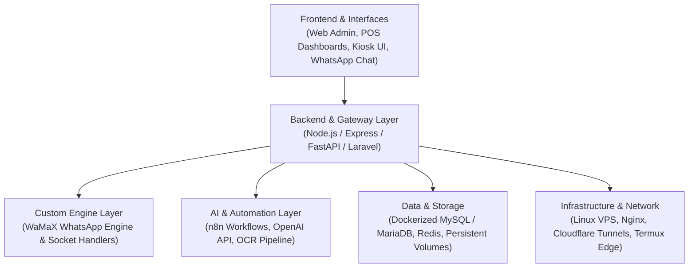

# 💫 Muhammed Shefin (msamods)
### Software Architect • Custom Automation & Messaging Engines • SaaS Product Builder • Infrastructure & DevOps

 

 

### 🌐 Connect With Me

  
  
  
  
  

---

## 👨‍💻 Engineering Profile & Overview

I am a **Systems Architect, Software Engineer, and Technical Product Builder** who works across the complete lifecycle of software: from engineering core application logic to managing containerized infrastructure, automating complex multi-system messaging workflows, and designing domain-driven SaaS products.

Rather than looking at software as isolated code files, I engineer complete operational ecosystems — connecting user interfaces, robust APIs, custom communication protocols, relational databases, AI automation pipelines, and bare-metal server infrastructure.

- 🚀 **Founder & Technical Lead**: Heading **[WhatYouWantKerala (wywk.in)](https://wywk.in)** and **MSA MODS** engineering initiatives.
- 🤖 **Custom Messaging Engine Architecture**: Creator of **WaMaX & WaMaX-Lite**, a high-concurrency custom WhatsApp automation engine featuring multi-device session management, strict anti-ban rate limiting, and interactive messaging payloads.
- 🖨️ **Hardware & Edge Systems**: Creator of **[AndroPrint](https://github.com/msamods/androprint)** — a zero-PC ESC/POS thermal printer server running natively on Android via Termux + Node.js with LAN & Cloud raw socket routing.
- 💼 **SaaS & Product Systems Design**: Architecting industry products including **WaySpeed POS** (offline-first restaurant POS), **WayFlow ERP**, **WaMaX Team Inbox**, **WhatsApp Recruitment ATS**, and **WayPay** (payment reconciliation workflows).
- 🐳 **Infrastructure, Docker & Linux Ops**: Hands-on systems administrator managing Docker container environments, multi-version MySQL/MariaDB deployments, persistent volume architectures, Cloudflare Tunnels, and Linux server recovery.
- 📈 **Technical SEO & High-Performance Web**: Deep mastery of Core Web Vitals (sub-second LCP, zero CLS), JSON-LD semantic schema markup, dynamic indexation pipelines, and edge-cached architectures.
- 🎓 **Academics**: BCA (2nd Year) @ **Vivekananda Global University**

---

## 🏗️ Core Architectural Pillars & Capabilities

<table width="100%">
  <tr>
    <td width="50%" valign="top">
      <h3>🤖 Custom Messaging Engines & Automation (WaMaX)</h3>
      <ul>
        <li><b>WaMaX Engine Architecture:</b> Built custom multi-device WhatsApp engine with automated QR handshake, session persistence, and full interactive UI elements (buttons/lists).</li>
        <li><b>Anti-Ban & Throttling Algorithms:</b> Token-bucket rate limiting, human typing jitter emulation, and intelligent queue distribution.</li>
        <li><b>Omnichannel Team Inbox:</b> Multi-number routing, role-based access control (RBAC), and automated staff assignment workflows.</li>
        <li><b>Automated Recruitment ATS:</b> WhatsApp candidate intake, automated CV processing, AI qualification ranking & candidate status tracking.</li>
        <li><b>Telegram & Headless Daemons:</b> High-throughput Telegram bots (Pyrogram/Telethon) and headless browser automation via Puppeteer & Selenium.</li>
      </ul>
    </td>
    <td width="50%" valign="top">
      <h3>🧠 AI, LLMs & Workflow Orchestration</h3>
      <ul>
        <li><b>n8n Intelligent Automation:</b> Multi-step autonomous pipelines connecting AI models, messaging webhooks, Google Sheets, and CRM databases.</li>
        <li><b>Document Intelligence & OCR:</b> Automated extraction of structured JSON from PDFs, DOCX, and scanned images (Tesseract OCR + AI parsing).</li>
        <li><b>Autonomous Business Agents:</b> Intelligent customer service responders, sales qualification bots, and natural language query processing over internal databases.</li>
        <li><b>Structured Data Extraction:</b> Enforcing strict JSON schema contracts and validation for business document processing.</li>
      </ul>
    </td>
  </tr>
  <tr>
    <td width="50%" valign="top">
      <h3>💼 SaaS, ERP & Offline-First POS Engineering</h3>
      <ul>
        <li><b>WaySpeed POS:</b> Offline-first restaurant & retail POS engine with order merging, kitchen display systems (KDS), token queueing, and receipt printing.</li>
        <li><b>WayFlow ERP & Commerce:</b> Multi-tenant management for inventory control, automated billing, customer ledger records, and role-based permissions.</li>
        <li><b>WayPay Financial Workflows:</b> Dynamic UPI QR generation, intent payments, cashier confirmation states, and transaction reconciliation logic.</li>
        <li><b>CRM Manager Pro:</b> Modern customer relationship platform with bulk communication pipelines, QR ticketing, and real-time activity metrics.</li>
      </ul>
    </td>
    <td width="50%" valign="top">
      <h3>🐳 DevOps, Docker & Linux Infrastructure</h3>
      <ul>
        <li><b>Docker Containerization:</b> Running and managing multi-service Docker deployments, volume mounts, persistent storage integrity, and container networking.</li>
        <li><b>Database Operations:</b> Hands-on troubleshooting of MySQL 5.7/8.0 and MariaDB 11.8, authentication plugin transitions, SQL modes, and storage engine recovery.</li>
        <li><b>Linux Server Administration:</b> Ubuntu VPS administration, SSH key management, systemd daemons, PM2 process management, and firewall security.</li>
        <li><b>Cloudflare Tunnels & Networking:</b> Exposing internal and edge services securely without opening public inbound ports, DNS routing, and reverse proxies (Nginx).</li>
        <li><b>Hardware Self-Hosting:</b> Low-power Linux servers, Raspberry Pi setups, and Android Termux bare-metal headless servers.</li>
      </ul>
    </td>
  </tr>
</table>

---

## 🌟 Star Projects & Systems Matrix

<table width="100%">
  <tr>
    <td width="50%" valign="top">
      <h3>🖨️ <a href="https://github.com/msamods/androprint">AndroPrint</a></h3>
      
<b>Android ESC/POS Thermal Print Server (Termux + Node.js)</b>

      
Eliminates bulky desktop computers by transforming any Android device into an always-on LAN & Cloud receipt printing server. Features PIN authentication, PDF/HTML/Image rasterization, web admin dashboard, and automated PM2 daemon execution.

      

        <code>Node.js</code> • <code>Android Termux</code> • <code>ESC/POS</code> • <code>Socket.io</code> • <code>PM2</code> • <code>Zero-PC</code>
      

    </td>
    <td width="50%" valign="top">
      <h3>⚡ <a href="https://github.com/msamods/WAMaX-Lite">WaMaX & WaMaX-Lite</a></h3>
      
<b>Custom WhatsApp Automation Engine & Multi-Device API</b>

      
High-performance in-house messaging engine engineered for multi-device connectivity, interactive button support, strict anti-ban rate limiting algorithms, MySQL session persistence, and unified CLI operations.

      

        <code>Custom Engine</code> • <code>Node.js</code> • <code>MySQL</code> • <code>REST API</code> • <code>Shell</code> • <code>Webhooks</code>
      

    </td>
  </tr>
  <tr>
    <td width="50%" valign="top">
      <h3>💼 <a href="https://github.com/msamods/CRM">CRM Manager Pro & whatsender</a></h3>
      
<b>Enterprise Messaging CRM & Campaign Platform</b>

      
Comprehensive customer relationship management system featuring broadcast engines, instant offer generators, automated QR code generation, contact categorization, and real-time analytics.

      

        <code>Laravel</code> • <code>PHP</code> • <code>Node.js</code> • <code>MySQL</code> • <code>TailwindCSS</code> • <code>Automation</code>
      

    </td>
    <td width="50%" valign="top">
      <h3>🌐 <a href="https://wywk.in">WhatYouWantKerala (wywk.in)</a></h3>
      
<b>High-Speed Regional Digital Directory & Web Ecosystem</b>

      
Engineered with performance-first architecture: sub-second Core Web Vitals, rich JSON-LD local business schema, edge caching via Cloudflare, and optimized search engine indexation pipelines.

      

        <code>Full-Stack Web</code> • <code>Technical SEO</code> • <code>Schema (JSON-LD)</code> • <code>Cloudflare Edge</code> • <code>Nginx</code>
      

    </td>
  </tr>
</table>

---

## 💻 Technical Stack & Tooling

  

 

| Technical Domain | Technologies, Protocols & Frameworks |
| :--- | :--- |
| **Languages & Scripting** | `JavaScript (ES6+)`, `TypeScript`, `Python`, `PHP`, `C++`, `Bash/Shell`, `PowerShell`, `SQL` |
| **Backend & Architecture** | `Node.js`, `Express.js`, `NestJS`, `FastAPI`, `Flask`, `RESTful APIs`, `OpenAPI / Swagger`, `Socket.io`, `Webhooks` |
| **Messaging & Bot Systems** | `WaMaX Custom WhatsApp Engine`, `WaMaX Team Inbox`, `Telegram Bot API (Pyrogram/Telethon)`, `Meta Graph API Concepts` |
| **AI & Automation** | `n8n Workflows`, `OpenAI API`, `Structured Output Parsing`, `OCR / Tesseract`, `Document Extraction Pipelines` |
| **Databases & Data Storage** | `MySQL (5.7 & 8.0)`, `MariaDB (11.8)`, `PostgreSQL`, `SQLite`, `Redis`, `LowDB / JSON Stores`, `Google Sheets API` |
| **Container & DevOps** | `Docker`, `Docker Persistent Volumes`, `Linux (Ubuntu/Debian)`, `Android Termux`, `Cloudflare Tunnels`, `Nginx Reverse Proxy` |
| **Technical SEO & Web Speed** | `Schema.org (JSON-LD)`, `Core Web Vitals (LCP, CLS, INP)`, `Dynamic Sitemaps`, `Robots.txt`, `Google Search Console`, `Lighthouse` |
| **Frontend & UI/UX** | `React.js`, `Next.js`, `TailwindCSS`, `Bootstrap`, `HTML5 / Semantic Web`, `Chart.js`, `Responsive Dashboards` |
| **Hardware & Peripherals** | `ESC/POS Thermal Protocol`, `Android ADB / Fastboot`, `Raspberry Pi 3B+`, `USB/Serial Barcode Scanners`, `FFmpeg` |

---

## 📈 System Architecture: How I Build

---

## 📊 Live GitHub Analytics

<table border="0">
  <tr>
    <td>
      
    </td>
    <td>
      
    </td>
  </tr>
  <tr>
    <td colspan="2" align="center">
      
    </td>
  </tr>
</table>

---

## 💡 Engineering Philosophy

> *"Code is only as valuable as the real-world friction it eliminates. Build robust systems, eliminate redundant dependencies, and engineer software that operates flawlessly under practical, real-world constraints."*

  

 

  Engineered by <b>Muhammed Shefin</b> • Founder @ <a href="https://wywk.in">wywk.in</a> • <b>MSA MODS</b>

